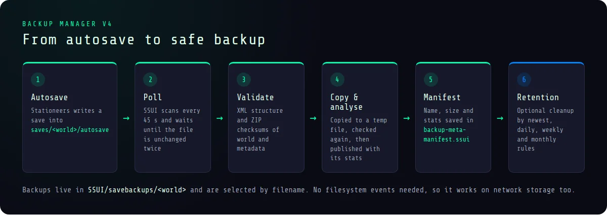
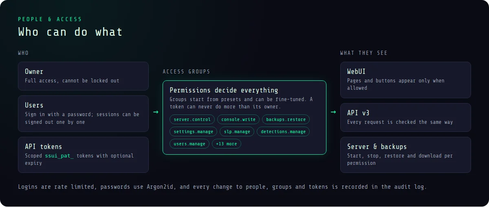
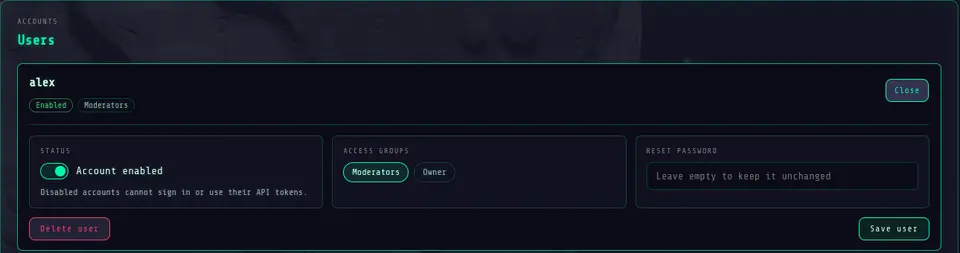
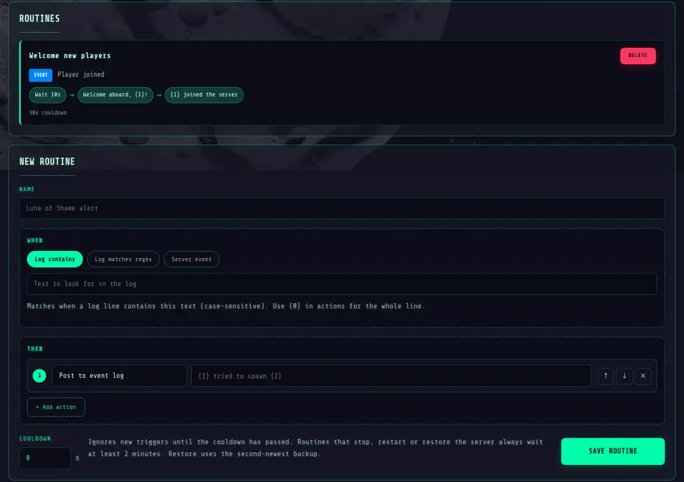
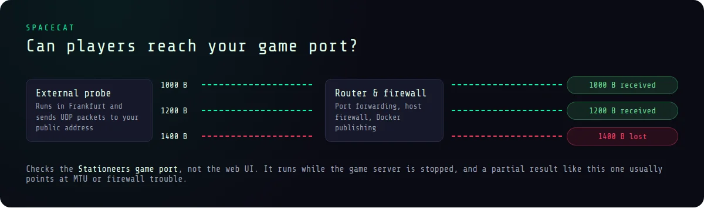
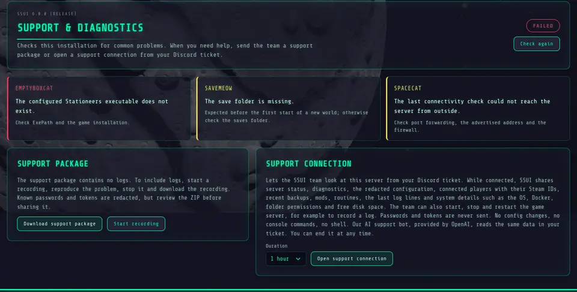
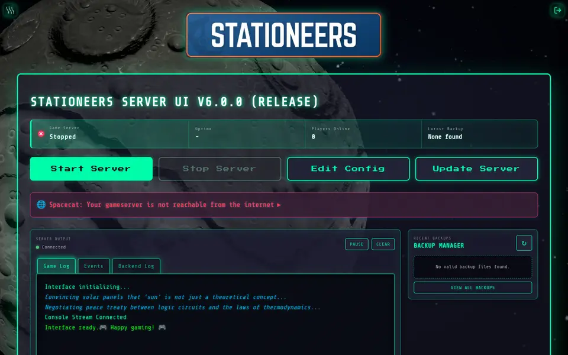
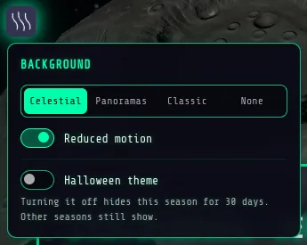

# What's new in v6

This was supposed to be v5.15. It got _slightly_ out of hand.

SSUI v6 is the largest StationeersServerUI update so far. The UI, the game server management and the general SSUI character are still the same. Around them, the backup system, Discord integration, API and security model grew a lot, and there is a support connection straight into your Discord ticket for everyone who ever got stuck.

This page walks through the highlights. Every single change is listed in the [v6 changelog](Changelog-v6.md).

!!! tip "For most users, upgrading is safe"
    If you use the normal WebUI and Discord integration, you can upgrade without changing your configuration. Existing users and data are migrated automatically. Read the [upgrade guide](Upgrade-Guide.md) first if you use the API, custom scripts, unusual Docker mounts or network storage.

!!! important "Coming from v5?"
    Update to **v5.14.1** first. It is the bridge that lets the v5 updater see and safely install a major version. SSUI never installs v6 without your explicit confirmation.

## Backup Manager v4

The backup manager no longer relies on filesystem notifications. It polls the autosave folder, waits until a save is stable across two scans, checks it and then copies it. This works much more reliably on CIFS, ZFS and network storage.

Backups now use their actual filenames instead of unstable numeric indexes. Every save is analysed (days played, players, things, networks and more) and recorded in a persistent manifest, with recovery after interrupted copies and missing storage. Restores no longer wait for a running autosave copy to finish. Existing legacy Safebackups folders are left untouched. [Backups and restores](Backup-System.md)

## Discord Server Hub

The old Discord control panel has been replaced by the Server Hub: one live message with server information, role-gated admin actions, backup downloads and restores, save statistics and temporary panels for restart and restore votes. Slash commands remain available and use the same permissions. [Discord integration](Discord-Integration.md)

## People & Access

Authentication is now mandatory. SSUI v6 adds proper users, permission groups, sessions and scoped personal API tokens. Permissions are enforced throughout the WebUI and API, with clear feedback when an action is unavailable.

Every user can change their password and sign out individual sessions. Administrators manage people, access groups with presets and fine-tuned permissions, and API tokens from one place. Existing v5 users are migrated automatically; everyone signs in once more after the upgrade, and old API keys need to be replaced with new tokens. [Access and HTTPS](Security-Considerations.md)

## Detection Manager routines

Custom detections grew up. Each entry is now a **routine**: one trigger and up to ten actions that run from top to bottom.

- **Triggers:** log contains text, log matches a regex, or a built-in server event (player joined or left, world saved, server joinable and more)
- **Actions:** post to the event log or Discord hub, announce in game, run a console command, save the world, wait, call a webhook, start, stop or restart the server, or restore the second-newest backup
- Regex capture groups and player data flow into the actions as `{1}`, `{2}` and so on
- Cooldowns, and server actions never overlap with each other or with the Discord hub

Existing custom detections become routines with a single event-log action. [Logs and detections](Log-Detection-System.md)

## Spacecat connectivity check

"Is my server reachable from the internet?" is now a button instead of a Discord thread. While the gameserver is stopped, Spacecat asks an external probe to send UDP packets of several sizes to your game port and reports which ones came back. A partial result often points straight at MTU or firewall trouble. [Server operations](Server-Operations.md#spacecat-check-gameserver-reachability)

## Support & Diagnostics

The **Support & Diagnostics** tab in the config page lists every finding that needs attention and creates a support package: a ZIP with a readable report and a redacted view of your settings. If logs are needed, start a recording, reproduce the problem, stop it and download the recording.

If SSUI does not start at all, run it with `-Diagnose`. It prints the same diagnosis as plain text, including folder permissions, mounts, free disk space, DNS and a Spacecat check, and exits without changing anything. [Support packages](Support-Packages.md)

### Support connection

Stuck? Open a **support connection** from the same tab, pick a duration, then press **Start remote connection** in your Discord ticket and enter the code. While it is open, the SSUI team sees your server status, diagnostics, redacted config, players, recent backups, mods, routines, the latest log lines and system details right in the ticket, and can start, stop or restart the game server to reproduce a problem.

SSUI only opens an outgoing HTTPS connection; no port is forwarded. Passwords and tokens never leave your server, there are no config changes, no console commands and no shell. Every request shows up in the tab, and **End connection** stops it immediately. Our AI support bot answers in the ticket as well; a server start, stop or restart always needs a click from you. [Privacy details](Support-Packages.md#privacy)

## API v3

The old `/api/v2` routes are gone. The new `/api/v3` uses a common response and error format across server management, backups, users, updates and settings. Configuration changes are typed and transactional, secrets are write-only, and only affected backend components are reloaded. This is intentionally a breaking change. [HTTP API](API.md)

## WebUI

SSUI now ships with Stationeers panoramas and a new celestial background that shows the world you play on. Use the celestial background. It is much cooler anyway. Backgrounds pause when the page loses focus and offer reduced motion, and the background menu now has tabs and switches.

The config page, People & Access, the Detection Manager, Themes, Support & Diagnostics and the update dialog are fully available in **English, German and Swedish**. And yes, there are seasonal planets for Halloween and Christmas, with a 30 day opt-out per season. [Web interface](Web-Interface.md)

## Runtime, updates and Docker

Runtime data now lives below `SSUI/`. Existing `UIMod` data is copied during the upgrade and the original stays untouched. New backup archives live below `SSUI/savebackups/<world>`.

The updater understands prereleases and requires explicit confirmation for major and prerelease updates. Docker installations report available updates without modifying their own container, and the supported layout is a single `./server-data:/app:rw` bind mount. [Docker](Docker-Guide.md)

The experimental terminal dashboard has been removed. The regular SSCLI remains.

---

[Documentation home](index.md) · [Upgrade from v5](Upgrade-Guide.md) · [v6 changelog](Changelog-v6.md)
